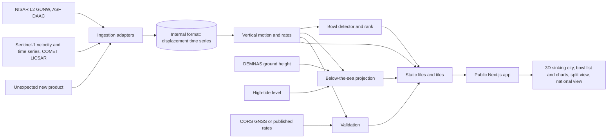

# PRD: Hollou — Jakarta subsidence and pumping evidence from NISAR radar

Status: Draft. The product scope is agreed. The method and the evaluation plan are open. Date: 29 October 2026. Challenge statement checked: 29 October 2026 (page last published 28 October 2026).

This PRD targets the NASA Space Apps Challenge 2026 challenge [Dancing with the SARs](https://www.spaceappschallenge.org/2026/challenges/dancing-with-the-sars/). The challenge levels are Intermediate and Advanced. The hackathon is on 14–15 November 2026. Judges score Impact, Creativity, Validity, Relevance, and Presentation. [Judging guide](https://spaceappschallenge.org/resources/judging-awards-guide)

The challenge asks teams to "build an interactive application that leverages radar remote sensing data from NISAR to track and visualize one or more types of surface changes". The desired outcome is "an open-source, user-friendly solution that translates complex radar observations into actionable insights". Teams must also "hypothesize the physical drivers behind what you see (or don't see) in the SAR data". The statement names "land surfaces deforming from … coastal subsidence" as one example of change.

The challenge resources are published on Friday, 13 November 2026. NASA did not publish a fixed dataset list before that. Check this PRD again when the resources are live.

The challenge page says: "Do not begin work on your projects until the hackathon begins." A prototype exists on the branch `feat/hollou-prototype`. See Open Decision 1.

## 1. Executive Summary

### Problem Statement

North Jakarta sinks by several centimeters each year, and some areas sink more than 10 cm a year. Deep groundwater pumping is the main cause. The ground above a heavy pump settles into a bowl. Jakarta banned groundwater use in large zones (Pergub 93/2021), but enforcement is weak, and piped water reaches only about 60% of the city. Regulators do not have a city-wide way to see where the ground still sinks, where the sinking points to pumping, and when the sea will reach a street.

### Proposed Solution

A public web app with no sign-in. It shows North Jakarta as a 3D sinking city on a map. NISAR radar shows the ground motion. A sea plane and a "below the sea" date show what the motion means. The app finds subsidence bowls and ranks them as possible over-pumping sites for inspection. Each bowl has a time-series chart: Sentinel-1 gives the long-term rate before the 2023 ban, and NISAR shows whether the bowl still sinks in 2026. A split-view slider compares L-band (NISAR) and C-band (Sentinel-1) coverage. A GNSS chart checks the radar against ground stations. A national view shows Jakarta, Semarang, and Pekalongan as velocity layers.

### Confirmed scope

| Item | Decision |
| --- | --- |
| Main user | Groundwater regulators: Pemprov DKI (Dinas SDA) and PAM Jaya. They decide where to inspect and where to extend piped water. |
| Secondary user | National monitoring staff (BIG, Badan Geologi). They use the national view with the same evidence. |
| Launch area | North Jakarta in detail. Jakarta, Semarang, and Pekalongan as velocity layers. |
| Data | Sentinel-1 for the long-term rate (before August 2023). NISAR for 2026 motion and L-band coverage. The ingestion must accept new or unexpected products. |
| Internal format | A displacement time series: dates × pixels. A velocity-only product enters as a rate with no history. |
| Processing | Batch jobs now. On-demand processing later. |
| Elevation | DEMNAS (BIG) for ground height. |
| Hero view | 3D sinking city with a sea plane and a "below the sea" date. |
| Bowl ranking | Rank by sinking rate, bowl depth, and change after the ban. No piped-water data in v1. |
| Validation | CORS GNSS time-series chart. Published station rates when CORS data is not available. |
| Access | Public. No sign-in for any app view. |
| Map stack | MapLibre (mapcn). deck.gl on MapLibre for the 3D sea plane and point layers. dithercn for charts. |
| Stack | The current repo: Next.js in `apps/web`, Python jobs in `apps/jobs`. |
| Deadline | The submission closes at the end of the hackathon on 15 November 2026. |
| Budget, team size | TBD. |

### Success Criteria

These targets are for the hackathon submission. They follow the judging criteria.

| # | KPI | Target | Judging criterion | How we measure |
| --- | --- | --- | --- | --- |
| 1 | Regulator task | At least 4 of 5 test users find the 3 highest-ranked bowls in one *kecamatan* and open the evidence for one of them in 3 minutes or less, without help. | Impact | Timed sessions within the permitted work period. Start from the home page. Record the time and any help that we gave. |
| 2 | User understanding | At least 4 of 5 test users can say, in their own words, why a bowl is a lead and not proof of a pump, and what the "below the sea" date assumes. | Impact, Validity | One question after the task. Two team members score the answer against the evidence panel. |
| 3 | Radar check | At every CORS station in the area, the radar rate and the station rate have the same sign, and the difference is inside the stated uncertainty. | Validity | The GNSS chart and a table of station rates. If CORS data is not available, compare with published rates and say so. |
| 4 | Evidence tracing | 100% of numbers in the map, charts, bowl list, and dates link to a source, period, scale, and method. | Validity | An audit of every panel, including 10 random bowls and 5 random streets. |
| 5 | Challenge fit | The app uses NISAR data, shows change over time, is interactive and open source, and states a physical driver for the change. | Relevance | A checklist review of the demo path against the challenge statement. |

Secondary targets:

- The split view shows an area where Sentinel-1 has low coherence and NISAR has a measurement, with numbers for both.
- The national view loads all three cities, and a user can compare their rates in 1 minute or less.

Out of scope for these targets: proof that a site pumps, measured flood dates, and legal enforcement results. The hackathon cannot measure these.

## 2. User Experience & Functionality

### User Personas

| User | Need | Decision the tool supports |
| --- | --- | --- |
| **Groundwater regulator** (main), Pemprov DKI and PAM Jaya | Enforce the groundwater-free zones. Reach full piped-water coverage. Use few inspectors well. | Which sites to inspect first, and which areas need piped water first. |
| **National monitoring staff** (secondary), BIG and Badan Geologi | One view of subsidence in coastal cities. CORS stations are far apart. | Which cities and areas need closer monitoring or more stations. |
| **The public** (viewer) | Understand why the city sinks and what it means for a street. | No decision. The hero view and the date explain the problem. |

### User Flows

**Regulator:**

1. Open the home page. The map flies from the globe to North Jakarta in 3D.
2. See the sinking city: ground motion colors, buildings, and the sea plane.
3. Move the year slider. The sea plane covers streets as the ground sinks.
4. Open the bowl list. Bowls are sorted by rank.
5. Select a bowl. The map moves to it and shows the bowl in 3D under the buildings.
6. Read the bowl chart: the long-term rate before the ban, and the NISAR motion in 2026.
7. Open the evidence for any number.
8. Share a link to the bowl.

**National staff:**
Open the national view → see Jakarta, Semarang, and Pekalongan velocity layers → select a city → see its rate range, its CORS stations, and its data dates → open North Jakarta detail where it is available.

### User Stories and Acceptance Criteria

#### F1. See the sinking city

**Story:** As a regulator, I want to see North Jakarta sink in 3D against the sea so that I can understand the size of the problem in one view.

**Acceptance criteria:**

- The map opens on a globe and flies to North Jakarta. With reduced motion, it goes to North Jakarta with no flight.
- Ground motion shows as a color layer with a legend in mm/yr. Buildings show as 3D shapes.
- A sea plane shows the high-tide level. A year slider runs from the current year to 2050.
- Each year on the slider lowers the ground by the measured rate. Areas below the high-tide level show as under the sea.
- A label states that this is a projection at current rates, with no sea walls, no pumps, and no sea-level rise, unless the user turns them on.
- Without a 3D view, a 2D map and the same numbers are available.

#### F2. Watch NISAR passes over time

**Story:** As a regulator, I want to step through each NISAR pass so that I can see that the data is fresh and real.

**Acceptance criteria:**

- The map shows each NISAR pair from the catalog. A slider and a play button step through the pairs.
- Each pair shows its two dates, the days between them, and its track and direction.
- A chart shows the share of clean signal (coherence) for each pair.
- A text states that one color cycle is about 12 cm of line-of-sight motion and that much of the color in a single short pair can be water vapor.
- Playback stops when the user moves the slider. Playback is off with reduced motion.

#### F3. Find likely pumping bowls

**Story:** As a regulator, I want a ranked list of subsidence bowls so that I can choose where to inspect first.

**Acceptance criteria:**

- The bowl detector finds areas that sink faster than their surroundings and have a bowl shape.
- Each bowl has a center, a radius, a peak rate, a depth, and a rank.
- The rank uses sinking rate, bowl depth, and the change in rate after the ban. The rank method is visible.
- Each bowl uses the label "lead for inspection, not proof of a pump".
- The tool shows no owner names and makes no claim about a building or a person.
- The list works with a keyboard and a screen reader, and it does not need the map.

#### F4. See one bowl over time

**Story:** As a regulator, I want to see whether a bowl still sinks after the ban so that I can judge whether enforcement works there.

**Acceptance criteria:**

- The chart shows Sentinel-1 displacement from 2014 to the ban, and NISAR displacement from June 2026.
- The ban date (August 2023) shows as a line on the chart.
- The chart shows the rate before and after, with uncertainty.
- If a source has no data for the bowl, the chart says so. Missing data is not shown as zero.
- The two sources are not joined into one line. Different sensors and reference points have different offsets.

#### F5. Compare L-band and C-band

**Story:** As national staff, I want to compare NISAR and Sentinel-1 coverage so that I can see where L-band adds measurements.

**Acceptance criteria:**

- A split-view slider shows Sentinel-1 coherence on one side and NISAR coherence on the other.
- The panel gives the share of area with usable coherence for each sensor, for the same area and a similar time span.
- The text explains in plain words why the longer wavelength keeps signal over trees, ponds, and open land.
- The slider works with a keyboard.

#### F6. Check the radar against the ground

**Story:** As national staff, I want to compare the radar with CORS stations so that I can decide how much to trust the map.

**Acceptance criteria:**

- The chart shows the CORS height time series and the radar displacement at the pixel over the station, on one time axis.
- The chart shows each rate and its uncertainty.
- If CORS data is not available, the chart shows the published station rate with its paper and period, and labels it "published rate".
- Line-of-sight motion is converted to vertical motion with a stated method before the comparison.

#### F7. See why

**Story:** As a regulator, I want to see the evidence behind each number so that I can defend an inspection decision.

**Acceptance criteria:**

- Each number opens a short text with the source, product, dates, scale, and method. For example: "NISAR L2 GUNW, track 10 ascending, 26 June – 13 October 2026, 80 m grid".
- The main view uses plain Bahasa Indonesia or plain English. Technical details appear when the user opens them.
- Satellite measurements, model estimates, projections, and published values have different labels.
- Old, missing, and low-coherence data have different states.

#### F8. Share a view

**Story:** As a regulator, I want to share a link to a bowl or a street so that I can discuss it with my team.

**Acceptance criteria:**

- The URL holds the selected bowl, the slider year, and the map position.
- Opening the link shows the same view.
- The shared view keeps the label "lead for inspection, not proof of a pump".

#### G1. See the national view

**Story:** As national staff, I want to see the rates in Jakarta, Semarang, and Pekalongan so that I can compare the cities.

**Acceptance criteria:**

- The map shows a velocity layer for each city, with one legend.
- Each city shows its rate range, the data source, and the dates.
- Cities with only Sentinel-1 data are marked. NISAR coverage is shown where it exists.
- Only North Jakarta has bowls, the sea plane, and the date in v1. Other cities say "detail not available".

### Experience Requirements

- Desktop first for regulators. The home page and the hero view must work on a phone that is 360 px wide.
- Main language: Bahasa Indonesia. English for the NASA demo. Both are planned; the default language is TBD.
- Meaning must not depend only on color. Rates show a number, and the legend has text.
- The user can do the core tasks with a keyboard or a screen reader. The bowl list works without the map.
- Follow the design system in `AGENTS.md`: glass only for floating map panels, tokens for color, and reduced motion support.

### Non-Goals

- Naming people, companies, or buildings as pumpers. A bowl is a lead for inspection.
- Piped-water service data in the bowl rank in v1.
- A flood forecast, an emergency warning, or a legal flood map.
- Sea-wall design levels.
- Sign-in, saved user data, or private records.
- Our own time-series inversion of raw Sentinel-1 data. We use a published Sentinel-1 product.
- On-demand processing of new areas in the MVP.
- A chat assistant or other generative AI features.
- A WhatsApp bot. It is a later idea.

## 3. AI System Requirements

The MVP uses no language model and trains no model. Fixed, tested processing steps calculate rates, find bowls, rank them, and project dates. This keeps every number traceable.

### Tool Requirements

- **Ingestion adapters.** One adapter for each source product. Each adapter reads the file, checks units, dates, grid, and reference, and writes the internal format. An adapter rejects a file with missing metadata and logs the reason. A new product needs only a new adapter.
- **Internal format.** For each pixel: a list of dates and displacements, with units, line-of-sight direction, reference point, and coherence. A velocity-only product stores one rate and no history.
- **NISAR time series.** Chain the 12-day GUNW pairs into a series for each track. Mask low-coherence pixels. Handle a gap in the chain without a false jump.
- **Vertical motion.** Combine ascending track 10 and descending track 18 to separate vertical and east-west motion. If only one track is available, assume vertical motion and say so.
- **Bowl detector.** Find local minimums in the vertical rate surface that are faster than their surroundings by a set amount and have a near-round shape. Record center, radius, peak rate, and depth.
- **Below-the-sea projection.** Ground height (DEMNAS) minus rate × years, compared with the high-tide level. Use the same vertical datum for both.
- **Jobs** run in `apps/jobs` with Python. Outputs go to static files or tiles that the web app reads. The app never downloads NISAR files during a page request.

### Evaluation Strategy

The method is not final. These checks are the minimum before the demo.

- **Rule tests:** At least 15 fixed cases for the adapters, the time-series chain, the bowl detector, and the projection. They include a missing pair, a velocity-only product, a file with wrong units, a flat surface (no bowls), and a synthetic bowl with a known center and depth.
- **Ground check:** Compare the radar rate with each CORS station in the area (KPI 3). If no CORS data, use published rates and report this.
- **Known-case check:** Muara Baru has published rates, from about 20–26 cm/yr in the past to about 10–12 cm/yr. Our long-term and 2026 rates must be in the same range, or the PRD records the difference.
- **Sensor check:** Where Sentinel-1 and NISAR both have good coherence, their vertical rates for the same period type must agree within the stated uncertainty.
- **Atmosphere check:** Show that the 2026 NISAR rate is not explained by water vapor alone, for example by comparing ascending and descending results or by using a stack of pairs.
- **Bowl check:** Compare bowl centers with any public deep-well or permit data we can find. If we find none, the PRD records this. A match is support, not proof.
- **Accessibility and motion checks:** Reduced motion, keyboard use, and the 2D fallback still permit the regulator task.

## 4. Technical Specifications

### Architecture Overview

- **Batch jobs** fetch products, run adapters, and write outputs. Jobs are idempotent: running a job again on the same input gives the same output and no duplicates.
- **The web app** reads static outputs. It has no database for the MVP.
- **Line-of-sight to vertical:** use both tracks where both cover a pixel. Keep the method and the incidence angles with the result.
- **Reference point:** choose a stable reference area for each track and store it. All rates are relative to that area.
- **Projection limits:** the projection assumes a constant rate. It does not include sea walls, drainage, pumping changes, or sea-level rise unless the user turns these on. A date is "at current rates", not a forecast.
- **Evidence records** include product, version, track, dates, units, grid, reference point, coherence threshold, and method for each output.

### Integration Points

| Source | Use | Notes |
| --- | --- | --- |
| NISAR L2 GUNW (provisional) | 2026 displacement, coherence, and the L-band side of the split view | 22 GUNW products over Jakarta in the ASF catalog: ascending track 10 (frame 174) and descending track 18 (frames 91, 92), 26 June – 13 October 2026, 12-day steps. About 2.3 GB per file. Full HDF5 needs an Earthdata login. Public browse images work without one. [ASF availability](https://nisar-docs.asf.alaska.edu/availability-overview/) |
| NISAR GCOV | Optional: backscatter and polarization context, such as water and ponds | Not needed for the MVP. The challenge suggests polarizations as an option. |
| Sentinel-1 (COMET LiCSAR / LiCSBAS) | Long-term rate 2014–2023, bowl shapes, the C-band side of the split view | Use a published product. Check frame coverage, dates, and license before the event. |
| DEMNAS (BIG) | Ground height for the projection and 3D view | Check the vertical datum and its age. Old heights in fast-sinking areas are already too high. |
| High-tide level | Sea plane height | Source TBD: a tide gauge such as Tanjung Priok, or a published value. Same datum as DEMNAS. |
| Ina-CORS (BIG) | Ground check | Access may need registration. Fallback: published station rates. |
| Building footprints | 3D buildings | From the basemap tiles (OpenStreetMap-based). For context only. |
| Administrative boundaries | *Kecamatan* and *kelurahan* names for bowls and streets | BIG boundaries. Check the reuse license. |

**Jakarta context.** Groundwater use is restricted by Pergub 93/2021, with stronger limits from August 2023. Piped water covers about 60% of the capital. BIG names three monitoring gaps: few CORS stations (473 in Indonesia), mixed subsidence and sea-level signals at the coast, and poor InSAR over vegetation. L-band addresses the third gap. [BIG, UN-GGIM 2024](https://www.un.org/globalgeospatial/sites/default/files/2026-04/4_bayu_sea_level_rise_and_land_subsidence_monitoring_in_indonesia_2-12-24.pdf) · [Jakarta Post](https://www.thejakartapost.com/opinion/2023/11/18/protecting-groundwater.html) · [SCMP](https://scmp.com/news/asia/southeast-asia/article/3241393/indonesia-aims-stop-jakarta-sinking-further-curbing-groundwater-use)

**Data warning.** BIG slides give two different Jakarta CORS rates: 6.4 cm/yr and 0.33 cm/yr (2015–2019). One station is not the city. Always show the station, the period, and the source.

**Physical driver hypothesis (for the challenge).** Deep groundwater pumping lowers the water pressure in the aquifer. The clay layers compact, and the ground above settles into a bowl around the pump. Where the ban works, the rate after 2023 should fall. Other drivers to state: building load on young sediments, and natural compaction. The demo must show where the data supports or does not support the pumping hypothesis.

### Security & Privacy

- The app is public and has no sign-in. It stores no user data.
- The app does not name owners, companies, or people. Bowls are areas, not addresses of a person.
- Keep Earthdata and other credentials in job secrets or `~/.netrc` on the machine that runs the jobs. Never put them in the repo or send them to the browser.
- Show source attribution and licenses for NASA, ESA/Copernicus, COMET, BIG, and OpenStreetMap in the app.
- The code is open source, as the challenge asks.

## 5. Risks & Roadmap

### Phased Rollout

| Phase | Date | Scope | Exit criteria |
| --- | --- | --- | --- |
| Prep | Now to 13 Nov 2026 | Confirm the rules on pre-event work. Check access to NISAR HDF5, Sentinel-1 products, DEMNAS, CORS, and tide data. Read the challenge resources on 13 November. Recruit test users. | Source gaps are documented. Prep stays inside what the rules allow. |
| MVP | 14–15 Nov 2026 | F1–F8 and G1 for North Jakarta and the three-city view. Demo video and project page. | Rule tests pass. All five KPIs are met, or gaps are reported honestly. The submission is complete. |
| v1.1 | Dec 2026 – Jan 2027 | Piped-water coverage in the bowl rank. More NISAR passes. Detail for Semarang and Pekalongan. | Test with regulator staff. KPI 3 holds with more data. |
| v2.0 | 2027 | On-demand processing for any area. Public bowl catalog. A bot that answers "when does my street flood?" | A partner agency uses the bowl list in a pilot. |

### Technical and Product Risks

| Risk | Effect | Response |
| --- | --- | --- |
| Space Apps rules limit work before the event | The prototype may not count, or may break the rules. | Read the rules now. If needed, keep the prototype out of the submission and rebuild during the event. |
| 108 days of NISAR is short | At 5–10 cm/yr the ground moves only 1.5–3 cm, close to the atmosphere noise. | Use Sentinel-1 for the long-term rate. Use NISAR for "still sinking or not", with uncertainty. Use both tracks and a stack, not one pair. |
| Water vapor in a single pair looks like motion | Users read noise as sinking. | Do not show a single pair as a rate. Label the pair view. Use the atmosphere check. |
| No Earthdata access in time | Only browse images are available. | Set up access during prep. Fallback: show browse images and Sentinel-1 rates, and say so. |
| The bowl detector finds no clean bowls | The main list is empty. | Test on Sentinel-1 data first. Show the rate map and say "no clear bowls" when that is the result. |
| A bowl is read as an accusation | Harm to a person or business. | No names. "Lead for inspection" label. Show the method and limits. |
| DEMNAS height is old or has a different datum | Wrong "below the sea" dates. | Record the datum and date. Show the date as a range. Label it a projection. |
| CORS data needs registration | No ground check. | Use published rates and report the fallback. |
| Line-of-sight is mistaken for vertical motion | Wrong rates. | Combine both tracks. State the method. |
| Unexpected data format in the resources | Ingestion fails. | Adapter design. Reject bad files with a reason. Add an adapter during the event. |
| 3D and data scope exceed the event time | No working demo. | Build in layers: rate map first, then bowls, then the sea plane, then the split view and GNSS chart. Keep the working version at each step. |

### Open Decisions

1. Confirm the Space Apps rules on the existing prototype and on work before 14 November.
2. Confirm the method: time-series chaining, atmosphere handling, reference point, and the vertical conversion.
3. Confirm the evaluation plan: which CORS stations, which published rates, and which tolerance counts as agreement.
4. Choose the Sentinel-1 product and check its coverage and license.
5. Choose the high-tide source and the vertical datum for DEMNAS.
6. Set the bowl detector thresholds and the rank weights.
7. Decide the default language for the demo.
8. Set the team size, the test users, and the device targets.
9. Decide whether GCOV polarizations add enough to include them.
